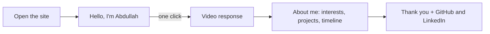

<div align="center">


# Abdullah Asif · Groton School Video Response

### One website. One goal: get my video in front of the admissions team in a single click.

[](https://YOUR-PROJECT.vercel.app)


</div>

<!--
  Before you publish:
  1. Replace YOUR-PROJECT.vercel.app (top of this file) with your real Vercel address.
  2. Optional: screenshot the site, save it as public/preview.png, and add this line under the "At a glance" heading:
     
-->

---

## At a glance

| | |
|---|---|
| **Who it's for** | The Groton School admissions team (Fall 2027) |
| **What it does** | Presents my short video response, plus the story behind it |
| **Main focus** | The video: it's one click from the top of the page |
| **Look and feel** | Red, bold and hand-made, like a student's notebook come to life |
| **Needs from visitors** | Nothing. No login, no sign-up, no cookies banner |
| **Built with** | Next.js · React · TypeScript · Tailwind CSS · Lucide icons |
| **Runtime dependencies** | Four (`next`, `react`, `react-dom`, `lucide-react`) |
| **Hosting** | Vercel |

## Why I built it this way

Admissions officers read a huge number of applications, so I wanted mine to feel like it was made by a real person who loves building things, not like a template.

- **Video first.** The headline, the big "Watch my video" button and the navigation all lead to the player. Everything else supports it.
- **Red on purpose.** Crimson carries the whole page, with navy and white as supporting colours.
- **Hand-made details.** Graph paper, doodles, handwritten notes, taped-on video and slightly crooked tiles make it feel personal.
- **Nothing to get in the way.** No account, no pop-ups, no autoplay.



## What it does

### 🎬 A video experience that can't break
- **16:9 player** with a large play button and the browser's own controls: play/pause, timeline, volume and fullscreen.
- **No autoplay and no forced looping**, so the visitor stays in control.
- **Graceful fallback.** If the video file is missing or fails to load, a clear placeholder appears instead of a broken player.
- **Confetti** pops the first time the video plays, and a spinning "press play" badge points the way.
- **One setting.** The video path lives in a single config file, so swapping the video takes seconds.

### ✏️ Hand-made, not templated
- **Hidden notebook doodles** (a basketball, a rook, a Rubik's Cube grid, an AI chip) are uncovered by the cursor on the red hero.
- Headline letters **drop in once** and hop when you hover over them.
- Handwritten notes, hand-drawn arrows and underlines, and graph-paper backgrounds.

### 🖱️ Interactive details
- **Custom cursor:** a springy red blob that stretches as it moves, leaves a trail of tiny squares, bursts on click, and turns into labelled buttons ("Play", "Go", "Open") over links.
- The video frame **tilts toward the mouse**.
- Interest tiles change colour and follow the mouse with a soft light. Each icon has its own animation: the basketball bounces and the cube spins.
- Magnetic buttons, project rows that sweep red on hover, a sliding timeline, two crossing ticker bands, a scroll progress bar and scroll-in reveals.

### 🧾 Real content, nothing invented
Everything on the page comes from my actual application: my projects (**Crescent Book**, a **free SAT prep app** and **Wristarc**), a dated timeline of courses and activities, what I do outside the screen, and where I'm from.

## Engineering highlights

- **Server and client split.** Sections that only show content are server components. Only the parts that react to the mouse or the scroll are client components.
- **No animation libraries.** Every effect is plain CSS or a small `requestAnimationFrame` loop, which keeps the page light.
- **The cursor never re-renders the page.** Its position and particles are updated directly through refs, and React state only changes when the cursor enters or leaves a link.
- **Reusable effect components.** `Reveal`, `Tilt`, `Magnetic` and `Cursor` are small, independent and easy to reuse.
- **Content is separated from layout.** Text lives in `src/config/content.ts`, and the video path lives in `src/config/site.ts`, so edits never require touching the design code.
- **Strict TypeScript** across the project.

## Built with care

| Area | What's in place |
|---|---|
| **Accessibility** | Semantic HTML, skip-to-content link, keyboard-friendly navigation and menu (Escape closes it), labelled video and buttons, visible focus styles, strong colour contrast |
| **Reduced motion** | Respects `prefers-reduced-motion`: animations, cursor effects and confetti switch off for visitors who ask for less motion |
| **Touch devices** | Cursor effects only run for a real mouse, so phones and tablets get a clean, fast page |
| **Responsive** | Designed down to small phones, with a mobile menu |
| **Privacy** | No tracking, login or database. No phone number, address, date of birth or family details appear anywhere on the site |
| **SEO** | Custom page title, meta description and Open Graph tags |

## Design system

| | |
|---|---|
| **Crimson** | `#C6283D`: the main colour |
| **Navy** | `#0B1F3A`: depth and hard shadows |
| **Royal blue** | `#174EA6`: small accents |
| **White / Off-white** | `#FFFFFF` / `#F5F7FA`: backgrounds and text on red |
| **Fraunces** | Headings: warm, expressive serif |
| **Caveat** | Handwritten notes |
| **Instrument Sans** | Body text and navigation |

## Project structure

```
src/
├── app/
│   ├── layout.tsx        # fonts, metadata, skip link, cursor
│   ├── page.tsx          # the page, section by section
│   ├── globals.css       # colours, graph paper, animations
│   └── icon.svg          # favicon
├── components/
│   ├── Nav.tsx           # navigation, mobile menu, scroll progress
│   ├── Hero.tsx          # headline, intro, hidden doodles
│   ├── Doodles.tsx       # the hand-drawn doodles
│   ├── VideoResponse.tsx # video section
│   ├── VideoPlayer.tsx   # player, fallback, confetti
│   ├── Marquee.tsx       # ticker bands
│   ├── About.tsx         # interests, projects, timeline, roots
│   ├── InterestTile.tsx  # tile with a mouse-following light
│   ├── Closing.tsx       # thank-you and links
│   ├── Footer.tsx
│   └── Cursor.tsx · Reveal.tsx · Tilt.tsx · Magnetic.tsx
└── config/
    ├── site.ts           # page title, description, video path
    └── content.ts        # projects, timeline, links
public/
└── videos/               # abdullah-response.mp4 goes here
```

## Run it locally

You need [Node.js](https://nodejs.org) 20.9 or newer.

```bash
git clone <your-repository-url>
cd <your-repository-folder>
npm install
npm run dev
```

Open [http://localhost:3000](http://localhost:3000). Changes appear as soon as you save a file.

| Command | What it does |
|---|---|
| `npm run dev` | Start the development server |
| `npm run build` | Create the production build |
| `npm start` | Run the production build locally |

## Make it yours

- **Replace the video:** save an MP4 as `public/videos/abdullah-response.mp4`, or change the path in `src/config/site.ts` (the comment there explains how). Keep the file under about 100 MB.
- **Change the text:** projects, timeline, links and the "where I'm from" paragraph are in `src/config/content.ts`.
- **Change the colours:** edit the `@theme static` block at the top of `src/app/globals.css`.

## Deploy to Vercel

1. Push the project to GitHub.
2. Go to [vercel.com/new](https://vercel.com/new) and import the repository.
3. Keep the default settings (Framework Preset: Next.js) and click **Deploy**.

Every push to `main` redeploys the site automatically.

## What's next

- Captions for the video, for viewers who watch without sound.
- An assistant that answers questions about me, using only the information on this site.

## Credits

Icons by [Lucide](https://lucide.dev) (ISC licence). Fonts by Google Fonts, served with `next/font`: Fraunces, Caveat and Instrument Sans (SIL Open Font Licence).

## Contact

- GitHub: [AbdullahAsif17311](https://github.com/AbdullahAsif17311)
- LinkedIn: [Abdullah Asif](https://www.linkedin.com/in/abdullah-asif-bba7a5342/)

---

<div align="center">

Made in Karachi, Pakistan · Groton School Applicant · Fall 2027

</div>
